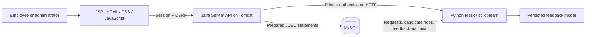
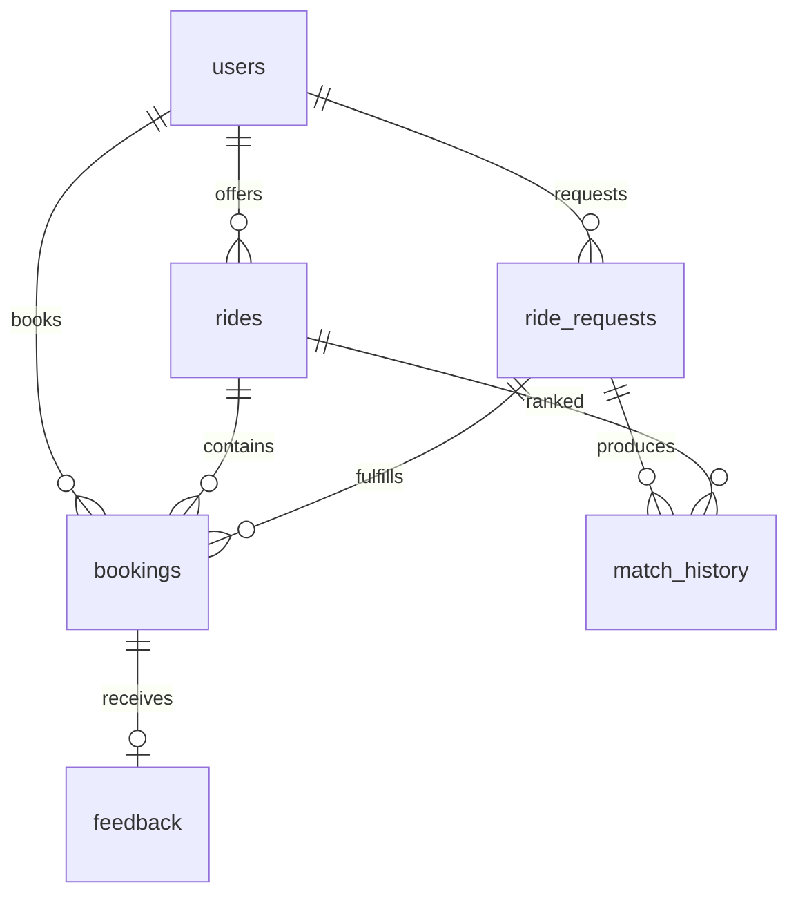

# SmartRideShare implementation guide

## Source review and scope

All 15 pages of Smart_RideShare_DA1_Presentation.pdf and all 6 pages of DIGITAL ASSESSMENT_CAO.pdf were read. Text extracts are saved beside this guide. The assessment's image-only architecture diagram was visually inspected. Document content was treated as project reference material; the user's direct request determined the implementation stack and permission to create local project files.

The presentation specifies Java, JSP/Servlets, Apache Tomcat, HTML/CSS/JavaScript, Python/scikit-learn, and MySQL. Both sources describe the same corporate commute recommendation and analytics prototype. The later user request adds map-based road routing and automatic live matching to the original prototype scope.

## Architecture

Java remains the database owner for application operations. Python receives only the data needed for ranking, training, or forecasting. The web browser cannot obtain the private service key.

## Requirement mapping

| Source requirement | Implementation |
| --- | --- |
| Registration/login | Auth screen, PBKDF2 passwords, session cookies, unique email, logout |
| Offer/request rides | Offer form and Find a ride form; coordinates, departure, price, seats, preferences |
| Data collection | MySQL users, rides, requests, bookings, match history, feedback, and audit logs |
| Data cleaning | Trimmed inputs, normalized emails, finite numeric ranges, valid times, candidate deduplication, invalid training sample rejection |
| Feature engineering | Pickup proximity, destination proximity, time compatibility, conversation preference, historical driver rating |
| Intelligent ranking | Scikit-learn similarity cold start; feedback-trained random forest blend; score explanations |
| Confirm and track shared rides | Transactional seat allocation and OPEN/CONFIRMED/COMPLETED/CANCELLED states |
| Dashboard | Completed rides, occupancy, savings, shared distance, CO2, recent trends, frequent routes |
| Predict demand | Random forest weekday/hour model, zero-filled hourly history, 7-day forecast |
| Feedback and continuous improvement | One rating per completed passenger booking; automatic retraining and model persistence |
| Administrator management | Account enable/disable, ride cancellation, configuration, report export, health, audit trail |
| Eclipse development | Maven WAR, Eclipse metadata, external Build/Start launch configurations, setup guide |

## Database relationships

`settings` stores the maximum endpoint gap, emissions factor, and solo-cost factor. `audit_log` records registration, login, booking, ride status changes, and administrator actions. Foreign keys protect relationships. Unique constraints protect email, ride/passenger combinations, match/request combinations, and feedback per booking. Multi-row booking, cancellation, and completion changes use transactions and row locks.

## API surface

All routes are relative to `/smartride/api`. JSON is used except the CSV export. Authenticated POST calls require `X-CSRF-Token` from `/me` or `/login`.

| Method | Route | Purpose |
| --- | --- | --- |
| POST | `/register`, `/login`, `/logout` | Account/session lifecycle |
| GET | `/me` | Current user and CSRF token |
| GET / POST | `/rides` | Browse upcoming rides / create an offer |
| POST | `/route` | Calculate road geometry, distance, duration and fare |
| POST | `/matches/preview` | Automatically rank a draft journey without creating a request |
| GET | `/recommendations` | Recompute matches for the current user’s next 20 future requests |
| POST | `/requests`, `/request/cancel` | Create / cancel a ride request |
| GET | `/mine` | Own offers, requests, and passenger bookings |
| POST | `/matches` | Rank and persist candidates for an owned open request |
| POST | `/book`, `/booking/cancel` | Reserve / release a seat |
| POST | `/ride/status` | Driver or administrator completes/cancels an offer |
| POST | `/passengers` | Driver/admin views booked passenger contact details |
| POST | `/feedback` | Rate a completed booking; trigger retraining |
| GET | `/analytics` | Scoped completed-ride metrics and admin forecast |
| GET / POST | `/admin/users` | List employees / enable or disable an employee |
| GET / POST | `/admin/settings` | Read / update matching and impact assumptions |
| GET | `/admin/rides`, `/admin/health` | Monitor rides and services |
| POST | `/admin/retrain` | Explicit feedback model training |
| GET | `/admin/report` | CSV ride report |

Private Python POST routes: `/recommend`, `/train`, `/forecast`, `/health`. They require `X-Service-Key` and listen on loopback only.

## Demonstration sequence

1. Sign in as Aarav and explore Overview and Analytics.
2. Find a ride from Velachery to Tidel Park tomorrow at 09:00; leave the default 45-minute window.
3. Compare matching explanations and book a seat. Open My journeys to see confirmation.
4. Sign in as Priya to see the offer and its passenger list. Use the work email shown to coordinate pickup.
5. Cancel a booking to show seat restoration. Rides can be completed only after their departure time.
6. Sign in as the administrator to inspect demand forecasts, account controls, matching settings, model health, and CSV export.

## Verification

Java unit tests cover password verification/salting, numeric validation, and CSV formula neutralization. Python unit tests cover matching exclusions, deduplication, geographic distance, service-key authentication, and cold-start/empty-history behavior. The integration suite exercises the live Java → MySQL → Python path, including concurrent last-seat bookings and the feedback lifecycle. Browser checks cover all main pages, screenshots, JavaScript errors, and mobile horizontal overflow. Results are saved in TEST-RESULTS.txt and screenshots/.

Passwords and service secrets are generated locally rather than committed in code. Session cookies are HttpOnly, POST requests use CSRF tokens and origin validation, SQL uses parameters, browser rendering escapes user strings, CSV cells neutralize formula prefixes, and administrative actions enforce roles. HTTP is intended for the local demonstration; an internet-facing deployment would require HTTPS and a deployment-specific operational review.

## Limitations relevant to the assessment

- Synthetic data demonstrates the complete pipeline; it is not evidence of model accuracy or real-world emissions reductions.
- OSRM provides road-route geometry and distance for map display and fare calculation. AI matching uses endpoint proximity rather than full road-path overlap. There is no continuous GPS tracking or live-traffic feed.
- Model retraining occurs on feedback, while forecasting fits from current recorded request history when the administrator opens analytics.
- Corporate identity verification, real payment gateway settlement, password-recovery email and a native mobile app are outside the prototype. Participant chat and simulated payments are now implemented; see the October update below.
- Rebuilds may invalidate sessions. Cancellation and state changes appear after actions or refresh. Visible Overview, Analytics, My journeys and matching pages refresh every five seconds; Admin refreshes service health. Hidden tabs pause polling. There is no push channel or offline matching worker.
- New deployment setup needs internet for dependencies. Prepared local application data works locally; map tiles and route calculation require internet.

Technical references: [Tomcat 10.1 / Servlet 6.0](https://tomcat.apache.org/tomcat-10.1-doc/), [scikit-learn RandomForestRegressor](https://scikit-learn.org/stable/modules/generated/sklearn.ensemble.RandomForestRegressor.html), [scikit-learn cosine similarity](https://scikit-learn.org/stable/modules/generated/sklearn.metrics.pairwise.cosine_similarity.html).

## October 2026 extension

`Chat.java` exposes `/chats`, `/chat/history`, `/chat/send` and `/chat/read`. Membership is enforced on the server. Messages are escaped by the browser, stored in `ride_messages`, and de-duplicated using a sender/client UUID. `ride_chat_reads` tracks read cursors.

`Payments.java` exposes authenticated POST endpoints `/payment/history`, `/payment/start` and `/payment/finish`. `demo_payments` records one row per attempt, with amounts taken from the stored ride fare. The simulator supports PENDING, PAID, FAILED, CANCELLED and REFUNDED. It has no gateway connection. Booking and ride cancellation update pending or paid attempts in the same transaction. Lock order follows ride then booking then payment. A refunded booking can be rebooked and paid through a new simulated attempt.

The payment button and history appear in My journeys. Payment is an optional teaching workflow; booking confirmation itself is not conditional on payment. Selecting a simulated method collects no bank or card details. Receipts explicitly state that no money moved.

See `TEACHER-EXPLANATION.md` for a complete classroom demonstration and `../output/pdf/Smart_RideShare_Project_Report.pdf` for the final 15-page report.
